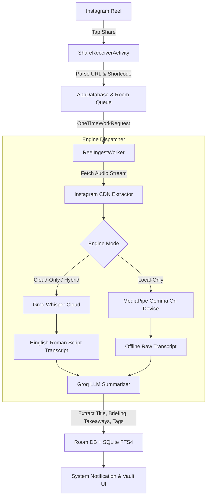

# Reel Library 📱⚡

[-3DDC84?logo=android&logoColor=white)](https://developer.android.com)
[](https://kotlinlang.org)
[](https://developer.android.com/jetpack/compose)
[](https://groq.com)
[](https://developer.android.com/training/articles/keystore)
[](LICENSE)

**Reel Library** is a native Android intelligence vault that transforms fleeting Instagram Reels into structured, searchable knowledge assets. Captured seamlessly via the system share sheet, each reel is ingested in the background, its audio transcribed into clean Hinglish/English text, and synthesized into actionable executive briefings using hybrid on-device and ultra-low-latency cloud intelligence.

---

## 🌟 Key Highlights

### ⚡ Dual-Engine Intelligence Architecture
- **Cloud-Fast Mode (Groq LPU)**:
  - Sub-second speech-to-text via **Whisper Large v3 Turbo** (`whisper-large-v3-turbo`) with Roman Latin Hinglish formatting.
  - Multi-tiered executive summarization with automatic fallback (`qwen/qwen3.8-27b` ➔ `llama-3.3-70b-versatile` ➔ `llama-3.1-8b-instant`).
- **Local On-Device Mode**:
  - 100% offline, privacy-preserving LLM inference using **MediaPipe Tasks GenAI** (quantized Gemma 2B) and local whisper weights.
- **Auto-Hybrid Dispatcher**:
  - Automatically assesses network availability, model weight availability, and user preferences to select the optimal processing pipeline.

### 📊 Real-Time Cloud Telemetry & Zero Mock Data
- **Live Latency & Network Ping**: Precision round-trip latency measured and displayed down to the millisecond (e.g. `⚡ 165ms`).
- **Granular Token Telemetry**: Real-time tracking of `prompt_tokens`, `completion_tokens`, and audio duration parsed directly from provider responses.
- **Color-Coded Status Diagnostics**: Live verification badges for HTTP `200 OK`, `401 Unauthorized`, and `429 Rate Limited`.

### 🛡️ Pre-Release Security & Privacy Hardening
- **SecureKeyVault**: Hardware-backed Android Keystore (`MasterKeys`) with zero plaintext fallback. In-memory session cache safeguards user API keys with atomic migration and safe deletion.
- **Prompt Injection Fencing**: User captions and audio transcripts are isolated inside `<spoken_transcript>` and `<post_caption>` XML blocks with strict boundary truncation (12,000 char transcript / 4,000 char caption) to prevent jailbreaking or instruction hijacking.
- **Network Audio Size Guard**: Strict 25 MB boundary guard (`MAX_GROQ_AUDIO_BYTES = 25L * 1024L * 1024L`) validated before network payload serialization.
- **Backup & Extraction Guard**: Configured with `android:allowBackup="false"` and Android 12+ `data-extraction-rules` excluding hardware-bound encryption keys and local databases from cloud backups and D2D transfers.
- **ProGuard / R8 Optimization**: Targeted constructor preservation for `@Serializable`, `@Entity`, and `Worker` classes while stripping diagnostic logging (`Log.d`, `Log.v`, `Log.i`, `Log.w`) from release binaries.

### 🎨 Obsidian Neumorphic UI
- **Design System**: Hand-crafted Obsidian Dark and Obsidian Light themes with smooth depth elevation and high-contrast typography.
- **Infinite Drawer & Grid Virtualization**: Smooth Jetpack Compose `LazyColumn` and `LazyVerticalGrid` virtualization eliminating pagination lag and item limits.
- **Instant Search & Topic Tagging**: Room SQLite FTS4 full-text search across transcripts, captions, titles, and generated tags.

---

## 🏗️ Ingestion Workflow



---

## 📦 Production Release Artifacts

Every production build generates a signed, minified, and verified APK package:

| Artifact | Location |
| :--- | :--- |
| **Production Release Package** | `release/ReelLibrary-release-v1.0.apk` |
| **Gradle Output Direct Path** | `app/build/outputs/apk/release/ReelLibrary-release-v1.0.apk` |
| **Target Signature Scheme** | **APK Signature Scheme v2 (Strict)** |
| **Signer Identity** | `CN=Reel Library, OU=Engineering, O=Reel Library, L=San Francisco, ST=CA, C=US` |

### One-Step Release Build Command:
```bash
./gradlew validateSigningRelease assembleRelease
```
*Note: The Gradle release task enforces strict verification and automatically copies and standardizes the output name to `ReelLibrary-release-v1.0.apk` in the root `release/` directory.*

---

## 📲 Quick Install

### Install via ADB to Connected Device:
```bash
adb install -r release/ReelLibrary-release-v1.0.apk
```

---

## 🛠️ Tech Stack & Architecture

- **Architecture**: MVI / MVVM with Clean Architecture & Unidirectional Data Flow (UDF)
- **Language**: Kotlin 2.0.21
- **UI Framework**: Jetpack Compose (BOM 2024.10.01) + Material 3
- **Local Persistence**: AndroidX Room 2.6.1 + SQLite FTS4
- **Security**: AndroidX Security Crypto (`EncryptedSharedPreferences`, `MasterKeys`)
- **Background Tasks**: AndroidX WorkManager 2.10.0
- **Networking**: Square OkHttp 4.12.0
- **Serialization**: Kotlinx Serialization JSON 1.7.3
- **Image Pipeline**: Coil Compose 2.7.0
- **On-Device AI**: Google MediaPipe Tasks GenAI 0.10.14

---

## 🚀 Getting Started for Developers

### Prerequisites
- **Android Studio**: Ladybug (2024.2.1+) or newer
- **JDK**: Version 21 (configured in `compileOptions`)
- **Android SDK**: API 36 Platform Tools

### Build Instructions

1. **Clone the repository**:
   ```bash
   git clone https://github.com/pratham1659/reel-library.git
   cd reel-library
   ```

2. **Run Unit Tests**:
   ```bash
   ./gradlew testDebugUnitTest
   ```

3. **Assemble Debug Build**:
   ```bash
   ./gradlew assembleDebug
   adb install -r app/build/outputs/apk/debug/app-debug.apk
   ```

4. **Assemble Signed Production Release**:
   Configure your `keystore.properties` in the project root:
   ```properties
   storeFile=/path/to/release.keystore
   storePassword=your_store_password
   keyAlias=your_key_alias
   keyPassword=your_key_password
   ```
   Then run:
   ```bash
   ./gradlew validateSigningRelease assembleRelease
   ```
   The finalized package will be output to `release/ReelLibrary-release-v1.0.apk`.

---

## 🔒 Security Policy

If you discover a security vulnerability or potential credential exposure, please avoid public disclosures. Open a private GitHub Advisory or report directly to the repository maintainer.

---

## 📄 License

```text
Copyright 2026 Reel Library Contributors

Licensed under the Apache License, Version 2.0 (the "License");
you may not use this file except in compliance with the License.
You may obtain a copy of the License at

    http://www.apache.org/licenses/LICENSE-2.0

Unless required by applicable law or agreed to in writing, software
distributed under the License is distributed on an "AS IS" BASIS,
WITHOUT WARRANTIES OR CONDITIONS OF ANY KIND, either express or implied.
See the License for the specific language governing permissions and
limitations under the License.
```
