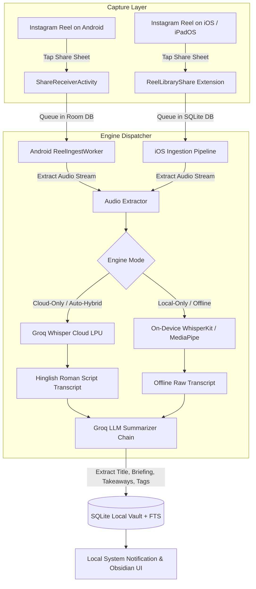

# Reel Library 📱⚡

[](https://github.com/pratham1659/reel-library/releases/tag/v1.2.3)
[-3DDC84?logo=android&logoColor=white)](https://developer.android.com)
[](https://developer.apple.com/ios/)
[](https://developer.apple.com/ipados/)
[](https://swift.org)
[](https://kotlinlang.org)
[](https://developer.android.com/jetpack/compose)
[](https://developer.apple.com/xcode/swiftui/)
[](https://groq.com)
[](https://developer.apple.com/documentation/security/keychain_services)
[](LICENSE)

**Reel Library** is a multi-platform native mobile intelligence vault (**Android & iOS/iPadOS**) that transforms fleeting Instagram Reels into structured, searchable knowledge assets. Captured seamlessly via the system share sheet, each reel is ingested in the background, its audio transcribed into clean Hinglish/English text, and synthesized into actionable executive briefings using hybrid on-device and ultra-low-latency cloud intelligence.

---

## 🌟 Key Highlights

### ⚡ Multi-Provider Cloud & On-Device Intelligence Architecture
- **Multi-Cloud AI Provider Selection**:
  - **Groq Cloud (LPU)**: Sub-second transcription via **Whisper Large v3 Turbo** and summarization via **Llama 3.3 70B** and **Qwen 2.5**.
  - **OpenAI**: Multimodal analysis and synthesis via **GPT-4o / GPT-4o-mini** and high-fidelity speech recognition via **Whisper-1**.
  - **Anthropic Claude**: Deep executive analysis via **Claude 3.5 Sonnet / Claude 3.5 Haiku** paired with hybrid audio transcription (OpenAI/Groq/WhisperKit).
  - **Custom / OpenAI-Compatible**: Plug in any self-hosted or proxy endpoint including **OpenRouter**, **DeepSeek**, **Together AI**, **Ollama**, or **vLLM**.
- **Local On-Device Mode**:
  - **iOS/iPadOS**: 100% offline, privacy-preserving speech transcription powered by **WhisperKit** running on the Apple Neural Engine (ANE) and local quantized models.
  - **Android**: 100% offline LLM inference using **MediaPipe Tasks GenAI** (quantized Gemma 2B) and local whisper weights.
- **Auto-Hybrid Dispatcher**:
  - Automatically assesses network availability (via `NWPathMonitor` on iOS / `ConnectivityManager` on Android), model weight availability, and user preferences to route processing.

### 📱 Universal iPhone & iPad Native Experience
- **Adaptive Multi-Column Grid**: Smoothly scales from 2 columns on iPhone up to 4–6 columns on iPad Pro / iPad Air.
- **iPadOS Multitasking**: Full native support for Split View, Slide Over, and Stage Manager window resizing.
- **1-Tap Share Sheet Extension**: Native Share Sheet integration (`ReelLibraryShare`) that ingests reel metadata into local SQLite in `< 200ms` without exceeding iOS sandbox limits.

### 📊 Real-Time Cloud Telemetry & Zero Mock Data
- **Live Latency & Network Ping**: Precision round-trip latency measured and displayed down to the millisecond (e.g. `⚡ 165ms • Cloud`).
- **Granular Token Telemetry**: Real-time tracking of `prompt_tokens`, `completion_tokens`, and audio duration parsed directly from provider responses.
- **Color-Coded Status Diagnostics**: Live verification badges for HTTP `200 OK`, `401 Unauthorized`, and `429 Rate Limited`.

### 🛡️ Pre-Release Security & Privacy Hardening
- **Hardware-Secured Key Vaults**:
  - **iOS**: Apple **Keychain Services** (`kSecClassGenericPassword`) backed by the **Secure Enclave**.
  - **Android**: Hardware-backed Android Keystore (`MasterKeys`) with zero plaintext fallback.
- **Prompt Injection Fencing**: User captions and audio transcripts are isolated inside `<spoken_transcript>` and `<post_caption>` XML blocks with strict boundary truncation (12,000 char transcript / 4,000 char caption) and anti-tag breakout neutralization.
- **Network Audio Size Guard**: Strict 25 MB boundary guard (`MAX_GROQ_AUDIO_BYTES = 25 * 1024 * 1024`) validated before network payload serialization.
- **Strict HTTPS & Domain Whitelisting**: Network extraction is restricted strictly to verified `https://*.instagram.com` domains, preventing SSRF or malicious redirects.

### 🎨 Obsidian Neumorphic UI
- **Design System**: Hand-crafted Obsidian Dark and Obsidian Light themes with tactile depth elevation and high-contrast typography.
- **Infinite Virtualization**: Smooth Jetpack Compose `LazyVerticalGrid` on Android and SwiftUI `LazyVGrid` on iOS eliminating pagination lag.
- **Instant Search & Topic Tagging**: SQLite FTS4 (Android Room) and SQLite FTS5 (iOS GRDB) full-text search across transcripts, captions, titles, and generated tags.

---

## 🏗️ Multi-Platform Ingestion Workflow



---

## 📦 Production Release Artifacts

| Platform | Target Artifact | Location | Packaging Scheme |
| :--- | :--- | :--- | :--- |
| **Android** | `ReelLibrary-release-v1.2.3.apk` | GitHub release v1.2.3 | APK Signature Scheme v2 |
| **iOS / iPadOS** | `ReelLibrary-v1.2.3.ipa` | GitHub release v1.2.3 | Apple Development (registered devices) |

---

## 🛠️ Multi-Platform Tech Stack

| Component | Android Architecture | iOS / iPadOS Architecture |
| :--- | :--- | :--- |
| **Language** | Kotlin 2.0.21 | Swift 6.0 (Strict Concurrency) |
| **UI Framework** | Jetpack Compose + Material 3 | SwiftUI (Obsidian Neumorphic) |
| **Local Persistence** | AndroidX Room 2.6.1 + SQLite FTS4 | GRDB.swift 6.x + SQLite FTS5 (BM25) |
| **Security** | AndroidX Security Crypto (`MasterKeys`) | Apple Keychain Services (Secure Enclave) |
| **Background Processing** | AndroidX WorkManager 2.10.0 | `BGProcessingTask` + `URLSession` |
| **Networking** | Square OkHttp 4.12.0 | Native Swift `URLSession` |
| **On-Device AI** | Google MediaPipe Tasks GenAI | Apple Neural Engine via WhisperKit CoreML |
| **Cloud Intelligence** | Groq LPU, OpenAI (GPT-4o / Whisper), Claude 3.5, Custom APIs | Groq LPU, OpenAI (GPT-4o / Whisper), Claude 3.5, Custom APIs |

---

## 🚀 Getting Started for Developers

### Android Build Instructions
1. **Prerequisites**: Android Studio Ladybug (2024.2.1+), JDK 21, Android SDK API 36.
2. **Run Unit Tests**:
   ```bash
   ./gradlew testDebugUnitTest
   ```
3. **Assemble Debug Build**:
   ```bash
   ./gradlew assembleDebug
   adb install -r app/build/outputs/apk/debug/app-debug.apk
   ```

### iOS & iPadOS Build Instructions
1. **Prerequisites**: macOS 14.0+ (Sonoma or Sequoia), Xcode 15.0+ or 16.0+ (Swift 6.0), XcodeGen (`brew install xcodegen`).
2. **Generate Xcode Project & Run Tests**:
   ```bash
   cd ios
   xcodegen generate
   xcodebuild test -scheme ReelLibraryTests -destination 'platform=iOS Simulator,name=iPhone 17'
   ```
3. **Install to Connected iPad / iPhone**:
   ```bash
   open ios/ReelLibrary.xcodeproj
   # Or via command line:
   xcodebuild build -project ios/ReelLibrary.xcodeproj -scheme ReelLibrary -destination 'id=<DEVICE_UDID>'
   ```

---

## 🔒 Security & Privacy Policy

Reel Library does not collect, sell, or transmit your personal data to any third-party analytics or tracking servers. All indexing, notes, and full-text searches happen **100% locally on your device**. Cloud AI requests only occur in Cloud Mode using your personal API key directly with your configured provider's official API (Groq, OpenAI, Anthropic, or your custom endpoint). API keys are stored exclusively in the hardware-backed Secure Enclave Keychain.

---

## 📄 License

Licensed under the MIT License. See [LICENSE](LICENSE) for details.

---

Crafted with ❤️ by pratham builds
