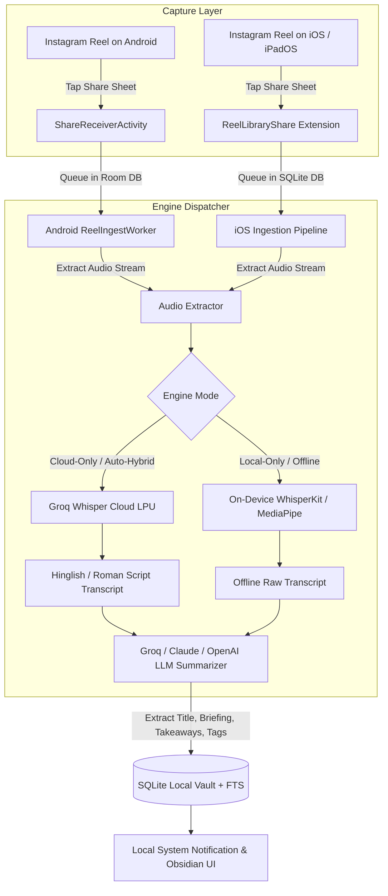

# Reel Library 📱⚡

[](https://github.com/pratham1659/reel-library/releases/tag/v1.2.5)
[-3DDC84?logo=android&logoColor=white)](https://developer.android.com)
[](https://developer.apple.com/ios/)
[](https://developer.apple.com/ipados/)
[](https://swift.org)
[](https://kotlinlang.org)
[](https://developer.android.com/jetpack/compose)
[](https://developer.apple.com/xcode/swiftui/)
[](https://groq.com)
[](https://developer.apple.com/documentation/security/keychain_services)
[](LICENSE)

A modern, open-source native Android & iOS mobile application built with Kotlin, Jetpack Compose, Swift 6, and SwiftUI. **Reel Library** transforms fleeting Instagram Reels into structured, searchable knowledge assets. Ingested seamlessly via the system share sheet, each reel is transcribed locally or via ultra-fast cloud LPUs, synthesized into actionable executive briefings, and stored securely in your private offline vault.

---

## 🚀 Download & Installation

Get the latest signed APK directly from the [Releases](https://github.com/pratham1659/reel-library/releases) tab.

- **Direct Download**: [`ReelLibrary-release-v1.2.5.apk`](https://github.com/pratham1659/reel-library/releases/download/v1.2.5/ReelLibrary-release-v1.2.5.apk)
- **Official Website**: [https://reel-library.web.app](https://reel-library.web.app)

### Verification (SHA-256 Checksum)

To ensure the downloaded APK has not been tampered with and matches the official build:

```bash
sha256sum ReelLibrary-release-v1.2.5.apk
```

**Official Release v1.2.5 SHA-256 Hash**:
```text
17225c02bff6f11841734accf55ae5c6941a6c5c6878b43389cce6a71f2420c7  ReelLibrary-release-v1.2.5.apk
```

Every GitHub release also includes an attached `SHA256SUMS.txt` file so you can verify integrity automatically:
```bash
sha256sum -c SHA256SUMS.txt
```

---

## 🛡️ Permissions & Security Transparency

This application is distributed independently outside the Google Play Store. To maintain full user trust, every declared permission is strictly scoped:

| Permission | Purpose | Why It's Needed |
| :--- | :--- | :--- |
| `INTERNET` | API requests | Syncing data with external endpoints (Groq LPU, OpenAI, Claude, or custom self-hosted endpoints) and extracting reel audio streams. |
| `POST_NOTIFICATIONS` | Local notifications | Alerting users when background audio transcription and executive briefing generation are complete. |
| `ACCESS_NETWORK_STATE` | Network monitoring | Checking whether Wi-Fi or cellular data is active before triggering background network jobs or Google Drive backups. |

- **Zero Analytics / Trackers**: No user telemetry, ad frameworks, crash loggers, or third-party trackers are bundled.
- **On-Device First**: All processing, transcripts, SQLite database, and stored credentials remain local on your device.
- **Zero High-Heuristic Installer Permissions**: `QUERY_ALL_PACKAGES`, `REQUEST_INSTALL_PACKAGES`, `SYSTEM_ALERT_WINDOW`, and `BIND_ACCESSIBILITY_SERVICE` are completely absent. In-app update checks redirect directly to GitHub Releases in the browser to eliminate heuristic flags.
- **Targeted `<queries>` Intent Filters**: Package queries are strictly constrained to `com.instagram.android` (for 1-tap reel deep linking), HTTPS web browsers, and mail clients.
- **Strict TLS Only (`usesCleartextTraffic="false"`)**: Enforced at the OS layer via `network_security_config.xml`. All unencrypted HTTP traffic is rejected.
- **Stripped Production Bytecode**: All `android.util.Log` calls (v, d, i, w, e, println) are completely stripped in R8 release builds.
- **Triple Signature Scheme**: Signed with APK Signature Schemes **v1, v2, and v3** for maximum compatibility and integrity across Android 8.0 through Android 15.

---

### ⚠️ Notes on Google Play Protect

Because this app is self-signed and distributed directly via GitHub, Android may display an **"Unrecognized app"** or **"Play Protect"** prompt during first install. This is standard behavior for sideloaded binaries signed with an independent developer certificate.

**To proceed:**
1. Tap **More details**.
2. Select **Install anyway**.

---

## 🛠️ Building from Source

### Clone the Repository
```bash
git clone https://github.com/pratham1659/reel-library.git
cd reel-library
```

### Android Build
1. Open the project in **Android Studio** (Ladybug 2024.2.1 or newer) with **JDK 17 or 21**.
2. Run unit tests:
   ```bash
   ./gradlew testDebugUnitTest
   ```
3. Build debug APK:
   ```bash
   ./gradlew assembleDebug
   ```
4. Build signed release APK:
   ```bash
   ./gradlew assembleRelease
   ```
   The compiled APK will be output to `app/build/outputs/apk/release/ReelLibrary-release-v1.2.5.apk`.

### iOS & iPadOS Build
1. **Prerequisites**: macOS 14.0+, Xcode 15.0+ or 16.0+ (Swift 6.0), and XcodeGen (`brew install xcodegen`).
2. Generate Xcode project & run tests:
   ```bash
   cd ios
   xcodegen generate
   xcodebuild test -scheme ReelLibraryTests -destination 'platform=iOS Simulator,name=iPhone 17'
   ```
3. Open in Xcode to install on connected devices:
   ```bash
   open ios/ReelLibrary.xcodeproj
   ```

---

## 🌟 Key Highlights & Architecture

### ⚡ Multi-Provider Cloud & On-Device Intelligence
- **Multi-Cloud AI Provider Selection**:
  - **Groq Cloud (LPU)**: Sub-second transcription via **Whisper Large v3 Turbo** and summarization via **Llama 3.3 70B** and **Qwen 2.5**.
  - **OpenAI**: Multimodal analysis and synthesis via **GPT-4o / GPT-4o-mini** and high-fidelity speech recognition via **Whisper-1**.
  - **Anthropic Claude**: Deep executive analysis via **Claude 3.5 Sonnet / Claude 3.5 Haiku** paired with hybrid audio transcription.
  - **Custom / OpenAI-Compatible**: Plug in any self-hosted or proxy endpoint including **OpenRouter**, **DeepSeek**, **Together AI**, **Ollama**, or **vLLM**.
- **Local On-Device Mode**:
  - **iOS/iPadOS**: 100% offline, privacy-preserving speech transcription powered by **WhisperKit** running on the Apple Neural Engine (ANE).
  - **Android**: 100% offline LLM inference using **MediaPipe Tasks GenAI** (quantized Gemma 2B) and local whisper weights.
- **Auto-Hybrid Dispatcher**: Automatically assesses network availability, model weight availability, and user preferences to route processing.

### 📱 Universal iPhone & iPad Native Experience
- **Adaptive Multi-Column Grid**: Smoothly scales from 2 columns on iPhone up to 4–6 columns on iPad Pro / iPad Air.
- **iPadOS Multitasking**: Full native support for Split View, Slide Over, and Stage Manager window resizing.
- **1-Tap Share Sheet Extension**: Native Share Sheet integration (`ReelLibraryShare`) that ingests reel metadata into local SQLite in `< 200ms` without exceeding iOS sandbox limits.

### 🎨 Obsidian Neumorphic UI
- **Design System**: Hand-crafted Obsidian Dark and Obsidian Light themes with tactile depth elevation and high-contrast typography.
- **Infinite Virtualization**: Smooth Jetpack Compose `LazyVerticalGrid` on Android and SwiftUI `LazyVGrid` on iOS eliminating pagination lag.
- **Instant Search & Topic Tagging**: SQLite FTS4 (Android Room) and SQLite FTS5 (iOS GRDB) full-text search across transcripts, captions, titles, and generated tags.

---

## 🏗️ Multi-Platform Ingestion Workflow



---

## 📦 Production Release Artifacts

| Platform | Target Artifact | Location | Packaging & Signing Scheme |
| :--- | :--- | :--- | :--- |
| **Android** | `ReelLibrary-release-v1.2.5.apk` | GitHub release v1.2.5 | APK Signature Scheme v1 + v2 + v3 |
| **iOS / iPadOS** | `ReelLibrary-v1.2.5.ipa` | GitHub release v1.2.5 | Apple Development (registered devices) |

---

## 🛠️ Multi-Platform Tech Stack

| Component | Android Architecture | iOS / iPadOS Architecture |
| :--- | :--- | :--- |
| **Language** | Kotlin 2.0.21 | Swift 6.0 (Strict Concurrency) |
| **UI Framework** | Jetpack Compose + Material 3 | SwiftUI (Obsidian Neumorphic) |
| **Local Persistence** | AndroidX Room 2.6.1 + SQLite FTS4 | GRDB.swift 6.x + SQLite FTS5 (BM25) |
| **Security** | AndroidX Security Crypto (`MasterKeys`) | Apple Keychain Services (Secure Enclave) |
| **Background Processing** | AndroidX WorkManager 2.10.0 | `BGProcessingTask` + `URLSession` |
| **Networking** | Square OkHttp 4.12.0 | Native Swift `URLSession` |
| **On-Device AI** | Google MediaPipe Tasks GenAI | Apple Neural Engine via WhisperKit CoreML |
| **Cloud Intelligence** | Groq LPU, OpenAI (GPT-4o / Whisper), Claude 3.5, Custom APIs | Groq LPU, OpenAI (GPT-4o / Whisper), Claude 3.5, Custom APIs |

---

## 📄 License

This project is licensed under the MIT License - see the [LICENSE](LICENSE) file for details.

---

Made with love & caffeine by **Pratham Studio**
